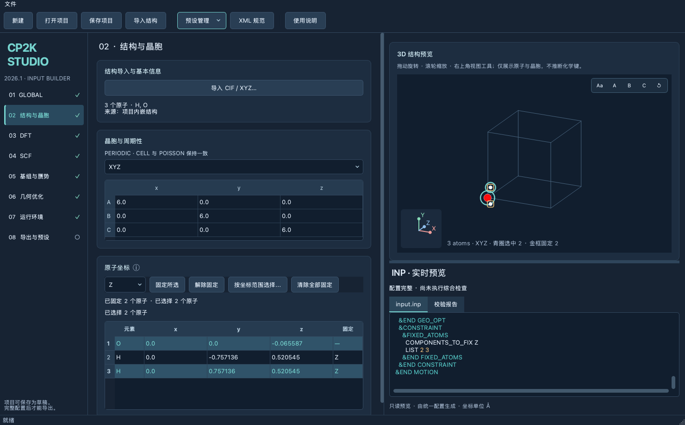

# 原子固定与坐标范围选择

第 01 页的「原子坐标」保留坐标编辑及隐藏的逐原子 KIND 映射，新增只读「固定」列、整行多选、固定/解除固定、清除全部固定、范围选择及数量统计。

操作控件统一为一行：`固定方向：[XYZ ▼] [固定所选] [解除固定] [按坐标范围选择…] [清除全部固定]`，使用 6px 间距及一致高度，操作栏背景透明，与卡片一致。窄窗口在该行内局部水平滚动，不挤压或截短控件本身的文字，也不增加整个页面的水平滚动。

晶胞与原子坐标通过 `CoordinateDelegate` 绘制为四位小数，EditRole 和表格条目保留完整值。双击编辑读取原始文本；文本未变化时不写回模型。只有提交了修改的文本才进入既有校验及数据更新流程，显示舍入不影响范围筛选、3D、约束、项目、INP 或计算包。

## 使用

1. 用 Ctrl/Cmd 多选或 Shift 连选原子，或点击「按坐标范围选择…」。
2. 范围对话框默认 Z，可切换 X/Y/Z；输入笛卡尔坐标的最小值与最大值（Å），支持负数、小数与科学计数法。闭区间比较使用绝对容差 `1e-9 Å`。无效、非有限或倒置区间留在对话框内提示；取消不改变选择。
3. 「选择原子」替换当前选择，只改变表格及 3D 高亮，不改变坐标或固定状态。无匹配时清空选择并显示非阻断提示。
4. 独立选择固定分量 XYZ、X、Y、Z、XY、XZ、YZ，然后点击「固定所选」。重复操作替换所选原子的分量；「解除固定」只清除所选，「清除全部固定」清除当前结构的全部固定设置。

点击主窗口内表格、3D 视图与原子操作控件之外的空白区域，取消当前选择及 3D 选中高亮，并将统计归零；已经固定的状态、坐标、项目及 INP 保持不变。固定/解除按钮、下拉框及其弹出列表、操作栏滚动条、3D 相机控制和范围对话框都保留操作所需的选择。此逻辑监听鼠标点击，不使用失焦清除；普通编辑器及其他可交互控件保持各自原有行为。

青色外圈表示选中，金色框表示固定，原子的元素颜色、晶胞与相机操作保持不变。3D 已移至右侧 INP 上方，跨页面保持可见，可拖动上下分隔条调整高度；视窗及视角按钮不再显示悬停提示。沿用原有前 3000 个原子的预览限制；选择、固定和导出处理完整结构。

3D 交互：左键拖动空白旋转，左键单击原子同步表格选择（Ctrl/Cmd 切换多选，Shift 添加），右键拖动平移，滚轮缩放。右键操作不改变已有选择，不弹菜单；原子、晶胞框及标记同步平移，左下角 XYZ 指示器保持固定。复位清除平移并恢复默认角度和缩放。相机偏移保存在视图内，按投影比例及旋转矩阵将鼠标位移映射到相机平面；坐标、晶胞、KIND、固定状态及 INP 均不受影响，也不会使项目或综合检查状态失效。切换页面保留相机；更换几何结构时重新适配，加载项目不持久化相机状态。

**坐标范围与固定分量含义不同**：[CP2K 2026.1 FIXED_ATOMS 官方规范](https://manual.cp2k.org/cp2k-2026_1-branch/CP2K_INPUT/MOTION/CONSTRAINT/FIXED_ATOMS.html)规定固定的是分数坐标分量。因此在非正交晶胞中，固定 X/Y/Z 不能解释为固定笛卡尔 X/Y/Z。范围筛选始终使用真实的笛卡尔坐标，与晶胞 A/B/C 方向和固定分量选择独立。页面标题旁帮助图标与分量框 Tooltip 均提供此说明。



## 数据与编号

`Structure` 包含与原子一一对应的唯一正整数 `atom_ids`，以及 `fixed_atoms`，例如：

```json
{
  "atom_ids": [10, 20, 30],
  "fixed_atoms": [
    {"atom_id": 10, "components": "XYZ"},
    {"atom_id": 30, "components": "Z"}
  ]
}
```

这里的 atom_id 是持久身份，不直接作为 CP2K LIST。生成时按当前模型坐标顺序转换为从 1 开始的编号，上例为 XYZ → LIST 1，Z → LIST 3。

表格排序只改变显示，行头仍标出最终 INP 的编号；收集坐标时通过 ID 查找编辑后的行，保留真实原子顺序与 KIND。程序性删除/重排使用 `Structure.reordered(atom_ids)`，返回按给定 ID 排列的子集，同步处理坐标、元素、KIND 和约束，移除被删除原子的固定记录。未新增通用原子删除/重排编辑器。

旧项目没有这些字段时自动建立顺序 ID，默认无固定原子；项目 JSON、计算包项目 JSON 均保留固定记录。导入新结构清除旧约束与选择。普通计算预设不保存结构约束，应用时保留当前结构的固定状态；明确替换坐标的预设会重建身份并清除旧固定记录，避免跨体系误用。

## 生成与检查

仅 GEO_OPT 且存在固定原子时，在现有 MOTION 的 GEO_OPT 后追加 CONSTRAINT。同分量合并为一个 FIXED_ATOMS，不同分量分节，不重复约束原子。大量编号每 32 个使用一个可重复 LIST 关键字，避免超长物理行。ENERGY 不输出约束，项目中的固定设置仍保留。

预览、单独 INP 与完整计算包共用同一生成器。综合检查使用现有官方 2026.1 XML 校验这些 Section；固定操作使第 08 步旧结果失效，单纯选择或表格排序不应使其失效。导入本程序生成的 INP 可恢复基本的 COMPONENTS_TO_FIX/LIST 约束；含 RESTRAINT 或额外选择器的复杂约束仍会提示未导入，避免误读。

## 修改文件

- `core/models.py`：FixedAtom、结构 ID/约束校验、删除/重排映射。
- `core/atom_constraints.py`：统一坐标范围筛选、按 ID 编辑固定状态、生成编号分组。
- `core/generator.py`：GEO_OPT 的 FIXED_ATOMS Section。
- `core/presets.py`：坐标替换时清除旧结构身份与约束，普通预设保持不包含约束。
- `core/input_import.py`：恢复基本固定原子 Section，保留复杂约束的警告。
- `ui/structure_panel.py`：多选、操作控件、固定列、排序与 ID 映射、数量和错误提示。
- `ui/coordinate_range_dialog.py`：坐标范围输入、验证与选择结果。
- `ui/structure_view.py`：选择/固定装饰，保留元素颜色及相机。
- `ui/main_window.py`：固定操作后立即刷新模型、预览和检查状态。
- `tests/test_atom_constraints.py`、`tests/test_atom_constraints_ui.py`：新增测试；`tests/test_kind_workflow.py` 更新可见列断言。
- `tests/test_atom_selection_interactions.py`：验证单行操作栏、窄窗口局部滚动、外部空白取消选择、真实下拉框/范围对话框、固定保留、坐标编辑提交及检查/保存状态。
- `README.md`、本说明及截图。

测试覆盖七种分量、重复修改/解除/清空、三轴闭区间、边界容差、无匹配/非法输入、选择与固定独立、排序及编辑后的 ID/KIND、3D 联动与相机保持、模型重排/删除、旧项目和新项目往返、预设、任务切换、官方 XML、基本 INP 导入、单文件/完整包导出和综合检查。未运行真实 CP2K 数值计算，未在 Windows/Linux 原生桌面验证快捷键与绘制。

本次 macOS / Python 3.12 全量结果：**341 passed，508 warnings，188.25 秒**；新增 43 项。使用临时 `XDG_CACHE_HOME` 隔离数据库缓存、Qt offscreen 渲染和 QTest 交互；缓存测试结束后清理。警告来自既有上游 XML 解析器、ASE/NumPy 及故意构造非法字段的 Pydantic 测试。另已验证实际 `main.main()` 入口进入 GUI 事件循环后正常关闭，以及检查通过后排序/选择保持检查状态。

后续单行操作栏与空白取消选择升级：新增 11 项，最新完整回归为 **363 passed，521 warnings，160.53 秒**，同样使用隔离缓存和 Qt offscreen。点击监听仅在所属窗口可见且存在选择时启用；清空选择或隐藏窗口后停用，避免在无关界面事件中增加开销。

右键平移升级：`ui/structure_view.py` 扩展相机位移与手势分流，统一绘制/拾取投影；`ui/structure_panel.py` 将原子点击接入现有稳定 ID 选择机制，`ui/main_window.py` 更新 3D 操作说明。`tests/test_structure_view_pan.py` 新增 26 项；最新完整回归 **389 passed，536 warnings，207.10 秒**（隔离缓存、Qt offscreen）。已检查平移前后窗口截图、固定标记及复位；未在 Windows/Linux 原生桌面或真实 CP2K 环境验证。

坐标显示与操作栏升级：晶胞和原子坐标复用 `ui/widgets/coordinate_delegate.py`，只在绘制时格式化四位小数，编辑及收集仍使用原始文本；操作栏增加「固定方向：」并使用透明背景。`tests/test_coordinate_display.py` 新增 15 项；完整回归 **404 passed，554 warnings，222.20 秒**（隔离缓存、Qt offscreen），并检查 1050/1480/1920px 窗口截图及操作栏背景像素。未执行真实 CP2K 数值计算或 Windows/Linux 原生桌面验证。
