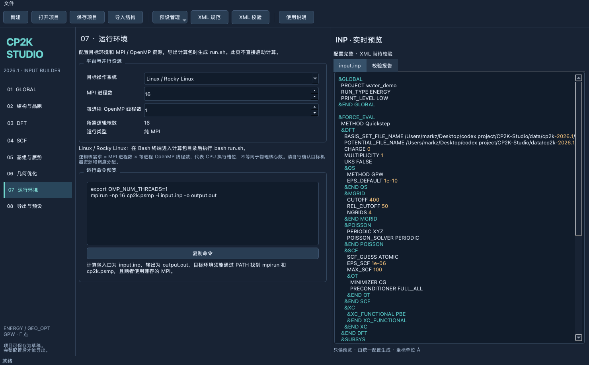
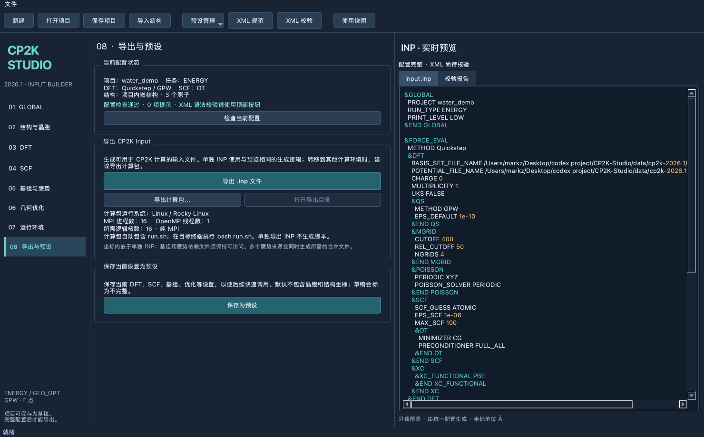

# 运行环境、MPI / OpenMP 与计算包启动脚本

> 本文记录运行环境模块升级及当时的测试结果。其后的文件引用修复和最新验证结果见 [INP 文件引用修复](file-reference-fix.md)。本次修复未更改运行脚本生成器。

本次在现有项目中接入运行配置，未修改科学输入生成器、XML 规范/校验器、数据库解析或推荐规则。首期仍由用户在目标终端启动计算，GUI 不启动进程。

## 实际文件清单

新增：

- `core/run_config.py`：独立执行环境模型、平台名称、逻辑执行槽位与模式、旧版总核数格式迁移。
- `core/run_script_generator.py`：预览/脚本/说明共用的命令、安全 Shell 转义和运行前检查。
- `core/export_notes_generator.py`：实际文件清单、资源概要、平台说明、启动命令、依赖和故障排查。
- `ui/run_environment_panel.py`：第 07 页、平台与两个正整数参数、派生结果、只读命令及复制按钮。
- `tests/test_run_environment.py`：模型、迁移、Bash、打包、预设隔离和单独导出回归。
- `tests/test_run_environment_ui.py`：导航、键盘修改、复制、项目恢复、迁移报告、ZIP 导出集成。
- `docs/run-environment.md`：本说明。
- `docs/images/run-environment.png`、`docs/images/export-with-run-config.png`：实测窗口截图。

修改：

- `core/models.py`：Project 增加 `run_environment`；非序列化的迁移提示记录。
- `core/project_io.py`：加载时迁移、计算包生成脚本/新说明、文件夹和 ZIP 交付。
- `ui/main_window.py`：八步导航、运行面板同步、迁移提示、导出格式选择、旧页码提示及 SpinBox 深色样式。
- `ui/export_panel.py`：第 08 页、运行环境概要、运行配置错误定位。
- `ui/preset_dialogs.py`：个人预设提示中的导出页码改为 08。
- `tests/test_layout_workflow.py`、`tests/test_ui.py`：更新八步导航和原有导出页面的断言。
- `README.md`：八步工作流、项目格式、脚本启动、ZIP、兼容范围和新增模块。
- `docs/ui-layout-upgrade.md`：标注为历史七步版本，链接本次说明。

`requirements.txt` 无需新增依赖。完整源代码包更新为 `dist/CP2K-Studio-source.zip`，上一次源代码包保留为 `dist/CP2K-Studio-source-before-run-environment.zip`。

## 界面与数据

导航为 GLOBAL、结构与晶胞、DFT、SCF、基组与赝势、几何优化、运行环境、导出与预设。前六页及右侧输入/报告保持原有逻辑，顶部预设和 XML 入口不变。

第 07 页默认 Linux / Rocky Linux、MPI=16、OpenMP=1；Windows 选项明确指 WSL2。MPI/线程数下限 1，上限与 QSpinBox 的 32 位整数上限一致。编辑参数后立即更新逻辑执行槽位、模式、命令预览和第 08 页概要。命令只读，可复制。没有总核数输入、执行模式选择器、程序路径或启动器选择器。



项目 JSON 新增：

```json
"run_environment": {
  "operating_system": "linux",
  "mpi_processes": 16,
  "omp_threads": 1
}
```

派生结果不另存：逻辑执行槽位 = MPI × OpenMP，OMP=1 为纯 MPI，否则为混合并行。逻辑执行槽位不等于物理核心数，也不是目标系统自动分配的资源。

缺少该字段的旧项目使用默认值。旧版根级或嵌套的 `total_cpu_cores`、`omp_threads` 在正整数且整除时转换；不可靠时恢复默认并在校验报告中提示，不弹出阻断对话框。现代格式的无效值按错误报告，不静默修改当前已打开项目。

预设保存依旧只捕获既有的科学参数白名单，排除运行环境。应用内置/个人预设不会覆盖当前运行平台或 MPI / OpenMP 配置。

## 导出与启动



第 08 页保留单独 INP、计算包、预设保存和打开目录。计算包可以选择文件夹或 ZIP，目标必须不存在。对当前项目快照先执行原完整性与 XML 校验，打包相对路径的结构/源库文件，再写入 run.sh、项目 JSON 和运行说明。ZIP 根目录直接包含这些文件；完整解压到一个文件夹后运行。

`export_bundle(project, destination)` 返回新包内的 input.inp 路径；`export_bundle(project, destination, archive=True)` 返回 ZIP 路径。文件夹导出在临时目录准备完毕后提交；ZIP 同样先在临时目录构造完成，以排他创建方式交付，写入失败会清理未完成的 ZIP 和暂存文件。

所有平台采用相同的 UTF-8 / LF Bash 脚本：自动切换到自身目录，检查输入、cp2k.psmp、mpirun，设置 OpenMP，再执行统一命令。实际运行缺少输入返回 2，缺少程序返回 127；MPI / CP2K 失败时保留其非零退出状态。脚本中的文件名经 Shell 转义，无 eval，不依赖开发机器工作目录。可执行权限尽力设置，但说明统一推荐：

```bash
bash run.sh
```

命令预览、脚本与说明调用同一个 `run_command`，固定使用 `mpirun`、`cp2k.psmp`、`input.inp` 和 `output.out`。输入文件名参数可处理空格、引号和 Shell 特殊字符；拒绝包外路径和换行/NUL。单独导出 INP 继续使用原来的生成器/校验链路，不附带 run.sh。

EXPORT_NOTES 列出实际文件、项目/版本、坐标单位、源库/合并说明、配置警告、运行资源、平台指引、运行前提、输出和常见错误。核心 API 禁用复制依赖时明确列出未打包数据，不能将包视为自包含。MPI 必须与 CP2K 的编译环境兼容；需要用户在目标机器申请足够资源。

## 验证结果与边界

- macOS / Python 3.12 / Qt offscreen：`python -m pytest -q`，**156 passed**，无失败/跳过；原有 105 项继续通过，新增 51 项。
- 99 条警告来自 cp2k-input-tools 0.9.3 上游 ElementTree 真值测试弃用提示，不是输入校验失败。
- `python -m pip check`：No broken requirements found。
- `python main.py`：进入 GUI 事件循环并持续运行 3 秒后由烟测正常终止进程；第 07/08 页截图已检查。
- Bash 测试包括语法检查、移包后从其他目录启动、空格/引号/命令替换字符的安全传参、MPI/CP2K 参数、OMP 环境变量、缺失输入/CP2K/MPI、退出状态 73 的传递、成功生成模拟输出、ZIP 内容和说明一致性。
- 同时覆盖 16×1、8×2、8×4、16×4、32×2；零、负数、布尔值、非整数和超出控件范围的值；项目往返、旧格式有效/失败迁移、预设隔离、单独 INP 无脚本及原有 XML/DFT/SCF/数据库回归。

未执行真实 CP2K / MPI 数值计算：开发环境没有安装 CP2K，模拟程序只验证启动协议，不证明数值结果或收敛。未在 Linux / Rocky Linux、WSL2 或不同 MPI 实现上实机测试；这些仍需目标环境验证。在当前 macOS 测试范围内未发现阻断性兼容问题。GUI 的原生 Windows 启动方式与计算包的 WSL2 Bash 运行方式是不同的使用场景。
